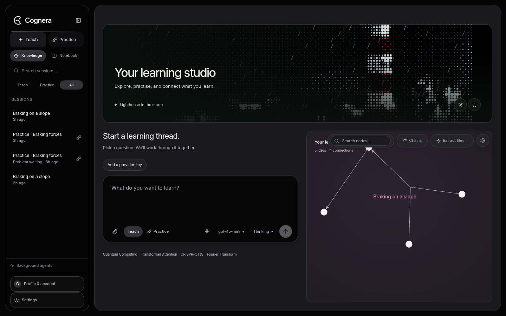

<h1 align="center">
  <br>
  Cognera
</h1>

<p align="center"><strong>An AI study workspace for learning any subject at your own pace.</strong></p>

<p align="center">
  <a href="#how-cognera-works">How it works</a> ·
  <a href="#run-locally">Run locally</a> ·
  <a href="docs/README.md">Documentation</a> ·
  <a href="https://github.com/niravgill4/LearnHarness/issues">Issues</a>
</p>

Cognera turns a question or a set of study materials into an interactive lesson. It checks what you already understand, builds from there, and asks you to use what you’ve learned. You can revisit your notes, practice problems, and connections across sessions.



## How Cognera works

- **Teach.** Choose a topic, set a time budget, and pick the teaching methods that suit you. Lessons can use explanations, diagrams, interactive simulations, and short comprehension checks.
- **Practice.** Work through problems and get feedback on your reasoning. You can type an answer or draw your work for questions where handwriting is easier.
- **Study your own materials.** Bring PDFs or PowerPoint decks into a lesson so the tutor can refer to the source material.
- **Notebook.** Organize notes into notebooks, sections, and pages. Add typed or handwritten notes and turn them into practice questions.
- **Learning atlas.** See ideas and reasoning chains from your lessons in a connected map. Follow links back to the sessions where you learned them.

## Run locally

Use Node 26 for the same setup as CI.

```bash
git clone https://github.com/niravgill4/LearnHarness.git
cd LearnHarness
npm ci
npm run plugins:setup
npm run dev
```

Open [localhost:3000](http://localhost:3000), then connect a supported provider and choose your models before starting a session. Provider availability and billing depend on your setup. See the [getting started guide](docs/getting-started.md).

For checks, development configuration, or desktop packaging, see [Development](docs/development.md) and [Desktop builds and releases](docs/desktop-release.md).

## Contribute

Report bugs and suggest improvements through [this repository’s issue tracker](https://github.com/niravgill4/LearnHarness/issues). See [Contributing](CONTRIBUTING.md) for development guidelines and [Security](SECURITY.md) for private reporting.

Cognera builds on [LearnHarness](https://github.com/amosblomqvist/learnharness). See [LICENSE](LICENSE) for the AGPL-3.0 terms.
